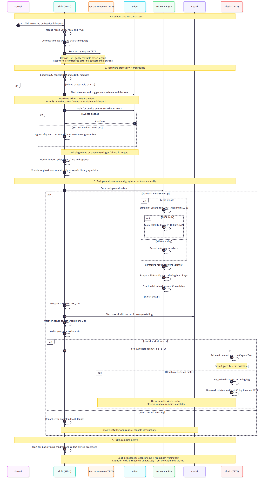

# USB Boot - Alpine Linux Tauri Kiosk

Builds a bootable UEFI USB drive image from Alpine Linux that boots directly into a minimal Wayland kiosk session and launches a Tauri application. The entire OS, kernel, and initramfs are packaged into a single Unified Kernel Image (UKI), so no separate bootloader config is required.

## How It Works

1. **Downloads** Alpine Linux rootfs and runtime packages (kernel, OpenSSH, Wayland/WebKitGTK stack) from the official mirror
2. **Builds** the Tauri app natively inside an Alpine chroot to produce a musl-linked binary
3. **Assembles** a custom initramfs with the rootfs, kernel modules, and an init script
3. **Creates a UKI** (`linux.efi`) containing the kernel + initramfs + boot cmdline via `ukify`
4. **Builds a GPT disk image** with an EFI System Partition containing the UKI as `BOOTX64.EFI`

At boot the init script starts a rescue console on TTY2, discovers devices with
eudev, then sets up networking and SSH (root/alpine) in parallel with the
seatd/Cage/Tauri kiosk on TTY1.

### Boot sequence



Mermaid source: [bootsequence.mmd](doc/bootsequence.mmd).

Legend:

- Numbered sections separate early boot, device discovery, parallel startup and
  the PID 1 wait loop.
- `par` marks concurrent work; `alt` shows alternative outcomes; `opt` shows an
  optional step. Network/SSH setup does not block the kiosk.
- The rescue console starts before device discovery. The udev settle and seatd
  socket waits are bounded at 10 and 5 seconds respectively.
- `openvt` launches the kiosk on TTY1. Graphics failure leaves diagnostic output
  there and does not disable the rescue console on TTY2.

### Boot diagnostics and rescue console

Kernel messages go to both the local display and serial port (`ttyS0`, 115200 baud).
The local display is the primary console for init output; boot timing milestones
are also saved in `/run/boot-timing.log`.

Press **Ctrl+Alt+F2** for a rescue login (`root` / `alpine`, once password setup
has completed). This console starts before udev discovery and remains available
if the graphical session fails. Use **Ctrl+Alt+F1** to return to the kiosk.
This is the same password-enabled test environment as SSH, not a production image.

If Cage/Tauri exits, TTY1 shows its exit status and the last 40 log lines.
The kiosk is not automatically restarted, so the failure remains available for
inspection. A missing seatd socket after 5 seconds prevents the kiosk launch and
produces an explicit error rather than reporting readiness.

Useful commands from the rescue console:

```sh
cat /run/boot-timing.log
cat /run/seatd.log
cat /run/kiosk.log
dmesg | tail -n 100
```

Logs are RAM-backed and lost at reboot. After changing init or the kernel
command line, rebuild with `sudo make disk` (or `sudo make disk-sb` for a signed
image), then copy the newly built EFI file or rewrite the disk image. Existing
copies on the USB drive are not updated automatically.

### Hardware firmware

The initramfs includes `lib/firmware/i915` (Intel graphics) and
`lib/firmware/rtl_nic` (Realtek Ethernet), supplied by Alpine's
`linux-firmware-i915` and `linux-firmware-rtl_nic` packages. Other firmware
directories remain excluded to limit image size. Compressed `.zst` firmware and
relative symlinks are preserved; the current Alpine LTS kernel supports
Zstandard-compressed firmware loading.

Run `sudo make disk` to rebuild from the cached rootfs without changing the
kernel. The build fails explicitly if either firmware directory is missing.
For an older cache without these packages, install them into the cached rootfs
before rebuilding:

```sh
sudo chroot build/alpine apk add linux-firmware-i915 linux-firmware-rtl_nic
sudo make disk
```

On the target machine, use the rescue console to check:

```sh
ls -l /lib/firmware/rtl_nic/rtl8168h-2.fw*
ls -l /lib/firmware/i915
dmesg | grep -Ei 'firmware|i915|r8169'
```

File inclusion can be checked during the build, but successful firmware loading
and GPU initialization must be retested on the actual Intel/Realtek hardware.

## Prerequisites

### System packages

Install all build dependencies (Debian/Ubuntu):

```sh
sudo apt install wget tar gzip cpio parted mtools make \
    systemd-ukify systemd-boot-efi python3-pefile \
    qemu-system-x86 ovmf
```

| Package              | apt package         | Used for                                  |
|----------------------|---------------------|-------------------------------------------|
| `wget`               | `wget`              | Downloading Alpine packages               |
| `tar`                | `tar`               | Extracting rootfs and APK archives        |
| `gzip`               | `gzip`              | Compressing initramfs                     |
| `cpio`               | `cpio`              | Creating initramfs cpio archive           |
| `make`               | `make`              | Build automation                          |
| `parted`             | `parted`            | Creating GPT partition table              |
| `mformat` / `mcopy`  | `mtools`            | Creating FAT32 filesystem on disk image   |
| `ukify`              | `systemd-ukify`     | Building Unified Kernel Image             |
| EFI stub             | `systemd-boot-efi`  | Provides `linuxx64.efi.stub` for ukify    |
| `python3-pefile`     | `python3-pefile`    | Python PE file library required by ukify  |
| `qemu-system-x86_64` | `qemu-system-x86`  | Testing the image in a VM                 |
| OVMF                 | `ovmf`              | UEFI firmware for QEMU                    |

KVM support (`/dev/kvm`) is recommended for usable VM performance.

### Kiosk image

Place the image to use as background at `tauri-welcome/src/kiosk-image.png`:

```sh
cp your-image.png tauri-welcome/src/kiosk-image.png
```

This file is used as the background image of the Tauri app and is copied into the initramfs as part of the build pipeline.

## Usage

```sh
sudo make         # build everything (downloads packages on first run)
sudo make run     # test in QEMU (SDL window + serial on stdio)
```

QEMU uses a virtio keyboard and an absolute-position virtio tablet. Both devices
use the existing `virtio_input` driver. Absolute coordinates avoid the need for
relative mouse capture, but do not resolve every host display/input issue.
These settings affect `make run` only, not physical USB mouse support.

If pointer motion freezes when running QEMU inside VMware, test the GTK display
backend instead of SDL while keeping the same guest image and input devices:

```sh
make run QEMU_DISPLAY=gtk,gl=off
```

The default remains `sdl,gl=off`. The GTK test requires a QEMU installation with
GTK display support (`qemu-system-x86_64 -display help` lists available backends).
Stop the previous QEMU instance before testing. No image rebuild is required
for a display backend change alone.

### Use a local APK executable

To skip downloading `apk.static`, point `APK` at an existing executable:

```sh
APK="$HOME/.cache/ngx-installer/apk.static" make download-alpine
```

The build forwards `APK` to `alpine-make-rootfs`, including when it invokes
the helper through `sudo`. If you run `make` itself with `sudo`, pass the
variable explicitly:

```sh
sudo make APK="$HOME/.cache/ngx-installer/apk.static" download-alpine
```

The file must be executable (`chmod +x "$HOME/.cache/ngx-installer/apk.static"`).
An invalid `APK` value stops the build before removing the cached rootfs.
With `APK` unset or empty, the existing behavior is unchanged: the helper uses
the host's `apk` if available, otherwise downloads `apk.static`.
This only skips the APK executable download; the rootfs helper and Alpine
packages still need to be available.

### Use a local proxy

Proxy variables are forwarded to the rootfs helper and the Tauri build chroot
(including APK, rustup, npm and Cargo), even through the build's internal `sudo`.
Both lowercase and uppercase forms of `http_proxy`, `https_proxy`, `all_proxy`
and `no_proxy` are supported. Make command-line assignments also work:

```sh
http_proxy=http://192.168.227.128:3142 \
APK="$HOME/.cache/ngx-installer/apk.static" make download-alpine
```

When running `make` itself with `sudo`, pass the settings explicitly:

```sh
sudo make http_proxy=http://192.168.227.128:3142 \
    APK="$HOME/.cache/ngx-installer/apk.static" download-alpine
```

`http_proxy` applies to HTTP downloads only. The default Alpine mirror uses
HTTPS; to cache Alpine packages through an HTTP-only caching proxy, use
`ALPINE_MIRROR=http://dl-cdn.alpinelinux.org/alpine` as an additional make
argument. Set `https_proxy` only if your proxy supports HTTPS tunneling.
Proxy settings are used at build time, not installed into the kiosk image.

SSH into the running VM:

```sh
ssh root@localhost -p 2222   # password: alpine
```

Write to a real USB drive:

```sh
sudo dd if=bootable-usb.img of=/dev/sdX bs=4M status=progress && sync
```

## Secure Boot (keep enabled)

If Secure Boot is enabled on your laptop, use the signed-image workflow.

### Host tools

Install the required host tools:

- `sbsigntool`
- `openssl`

### Build and sign

```sh
make sb-keygen
make disk-sb
```

Write the signed image:

```sh
sudo dd if=bootable-usb-sb.img of=/dev/sdX bs=4M conv=fsync status=progress
sync
```

### What this does

- Creates a local Secure Boot signing keypair and cert:
    - `build/keys/db.key`
    - `build/keys/db.crt`
    - `build/keys/db.cer`
- Signs the UKI:
    - `build/linux-sb.efi`
- Creates a separate signed disk image:
    - `bootable-usb-sb.img`
- Copies the certificate into the EFI partition as:
    - `EFI/BOOT/DB.CER`

### Important

- Your custom cert is trusted only after enrolling it into firmware `db`.
- Secure Boot can stay ON, but you must enroll `db.cer` in UEFI Key Management (Enroll from disk / Add DB key).
- If your BIOS does not allow direct `db` import, use a shim + MOK flow.

## Make Targets

| Target              | Description                             |
|---------------------|-----------------------------------------|
| `all` / `disk`      | Build the bootable disk image (default) |
| `download-alpine`   | Download Alpine rootfs and packages     |
| `tauri-build-env`   | Set up the Tauri build chroot (once)    |
| `tauri-build`       | Compile the Tauri app binary            |
| `initramfs`         | Create the initramfs archive            |
| `uki`               | Create the Unified Kernel Image         |
| `sb-keygen`         | Generate Secure Boot key and cert       |
| `uki-sb`            | Sign UKI with local Secure Boot key     |
| `disk-sb`           | Create signed bootable disk image       |
| `run`               | Launch in QEMU                          |
| `clean`             | Remove all build artifacts              |

## Tauri App Build

The kiosk UI is a [Tauri](https://tauri.app/) application compiled natively inside an Alpine Linux chroot so that the resulting binary links against musl libc (matching the initramfs runtime).

The build is split into two stages to avoid repeating the slow environment setup on every code change:

### Stage 1 — environment setup (run once)

Clones `build/alpine` into `build/alpine-build`, installs build dependencies via `apk`, and bootstraps a Rust toolchain via `rustup`. Creates a stamp file `build/alpine-build/.deps-ready` so this step is skipped on subsequent builds.

```sh
sudo make tauri-build-env
```

Re-run this if `TAURI_BUILD_DEPS` changes or you want to rebuild the chroot from scratch.

### Stage 2 — compile (run on every code change)

Copies source files into the existing chroot, runs `npm run build` (frontend), then `cargo build --release` using the rustup-managed toolchain. Verifies the output binary is musl-linked.

```sh
sudo make tauri-build
```

### Common workflows

| Situation | Command |
|-----------|---------|
| First-time build | `sudo make tauri-build-env && sudo make tauri-build` |
| Rust/JS source changed | `sudo make tauri-build` |
| Build deps changed | `sudo make tauri-build-env && sudo make tauri-build` |
| Force full rebuild | `sudo make -B tauri-build-env tauri-build` |
| Full image build | `sudo make disk` *(calls tauri-build automatically)* |

## Project Structure

- `init` — Boot init script (mounts filesystems, networking, SSH, eudev/seatd, cage, Tauri launch)
- `tauri-welcome/src/kiosk-image.png` — Background image for Tauri app, copied into initramfs (**required**, not tracked in git)
- `Makefile` — Full build pipeline
- `build/` — Build outputs (rootfs, initramfs, kernel, UKI)
- `build/tools/alpine-make-rootfs` — Downloaded helper script for building the Alpine rootfs

## Customization

### Rootfs packages

Edit `ROOTFS_PACKAGES` in the `Makefile` to add or remove Alpine packages from the rootfs.

If you change runtime package sets in a way that affects shared libraries or cursor/theme assets, rebuild the cached rootfs to avoid stale cache issues:

```sh
sudo rm -rf build/alpine build/vmlinuz-lts
sudo make repack
```

### Init behavior

Edit `init` to customize boot-time behavior (network, SSH policy, module loading, compositor launch, app command).

Current policy is intentionally VM-oriented and minimal:

- Generic graphics modules: `drm`, `drm_kms_helper`, `simpledrm`, `virtio_gpu`
- Input modules for QEMU/virtio devices
- Root password SSH login enabled for testing

### Rootfs post-install script (`alpine-make-rootfs --script-chroot`)

The build uses [`alpine-make-rootfs`](https://github.com/alpinelinux/alpine-make-rootfs) to assemble the Alpine rootfs. You can pass a script with `--script-chroot` to run commands **inside a chroot of the freshly built rootfs** during the build — for example to configure services with `rc-update`, write config files, or run `apk` commands:

```sh
sudo alpine-make-rootfs --script-chroot --packages "openssh" ./build/alpine ./setup.sh
```

With `--script-chroot` the script runs as if it were running on the target Alpine system. Without it, the script runs on the host with `$ROOTFS` pointing to the rootfs directory.
